

<h1 align="center">MAestro Cards</h1>

<b>Your smart home in one consistent style.</b>

Music, climate, lighting, cameras and device states — a collection of cards and badges for Home Assistant with a shared design, compact controls and expandable panels.

## Installation

1. HACS → ⋮ → **Custom repositories** → add `https://github.com/Endruch/MAestroCards`, category **Integration**.
2. Find **MAestro Cards** in HACS and install it.
3. Restart Home Assistant.
4. **Settings → Devices & services → Add integration → MAestro Cards.**

The MAestro cards and badges then appear in the card picker of any dashboard. No resources need to be added manually.

## Requirements

| Card | What it needs |
|---|---|
| **Player** | Music Assistant and its Home Assistant integration. |
| **Thermostat** | A `climate` entity, or separate sensors and switches for a custom setup. |
| **WLED** | A WLED controller added through the WLED integration in Home Assistant. |
| **NVR** | Any Home Assistant cameras: generic, ONVIF, Ring and others. Recordings require Frigate and its integration. |
| **Switch** | A supported Home Assistant entity: switch, light, script, button or another device. |
| **Dimmer** | A `light` entity with brightness support. |
| **Cover** | A `cover` entity. Position control requires the device to support it. |
| **Sensor / info badges** | Home Assistant sensor entities. Graphs need state history to be available. |

## MAestro Player

**A multiroom player for Music Assistant.**

One card controls all Music Assistant players: it groups rooms, sets the volume of each one and shows what is playing in the other rooms. A separate power button turns your amplifier or receiver on and off.

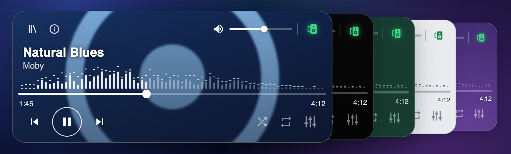

### Player panels

- **Track info** — lyrics with the current line highlighted, artist and album descriptions.
- **DSP & equalizer** — Music Assistant's 10-band equalizer, preamp and ready-made presets.
- **Multiroom** — per-room volume, grouping rooms together and what is playing elsewhere.
- **Music library** — favorites, recently and most played, playlists, albums, artists, tracks and radio.

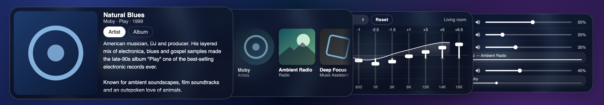

## MAestro Thermostat

**A universal climate card.**

Works with any `climate` entity — from Nest and Ecobee to air conditioners — or can be built from separate sensors and relays. Temperature and humidity history, device modes and quick access to the thermostats in other rooms. Supports °C and °F.

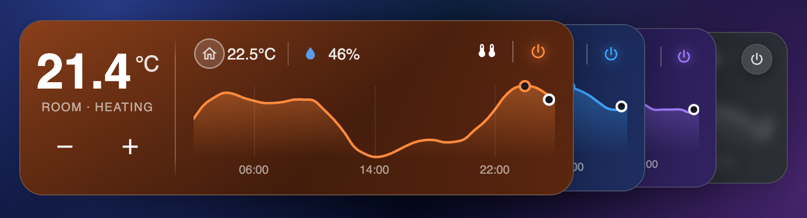

## MAestro WLED

**The full power of WLED in a Home Assistant card.**

Segments, effects, palettes, presets and playlists — everything WLED offers, without opening its web interface. In compact mode the card takes a single row; the rest opens when you need it.

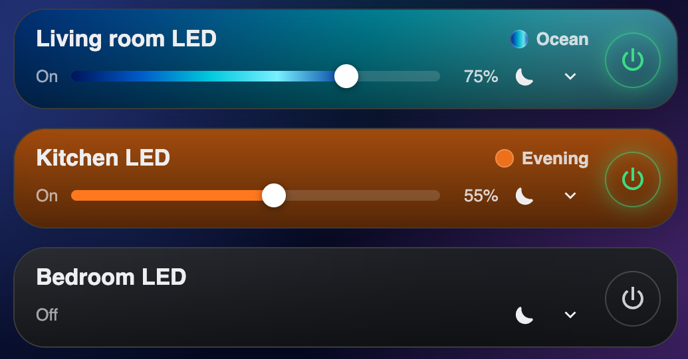

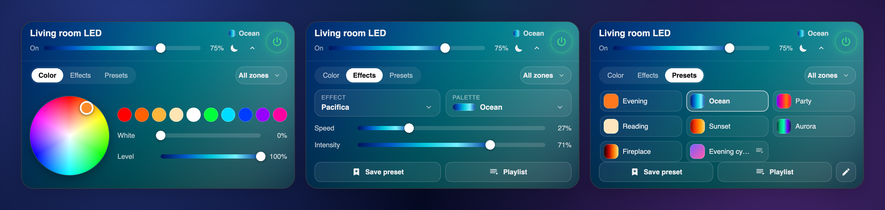

## MAestro NVR

One, four or nine cameras on screen, paging with arrows or swipes, Birdseye. Works with any Home Assistant cameras — generic, ONVIF, Ring and others.

Frigate cameras get a low-latency live stream and recordings: a timeline from one hour to a full day, event markers and previews, date and time picker, playback speed and clip download.

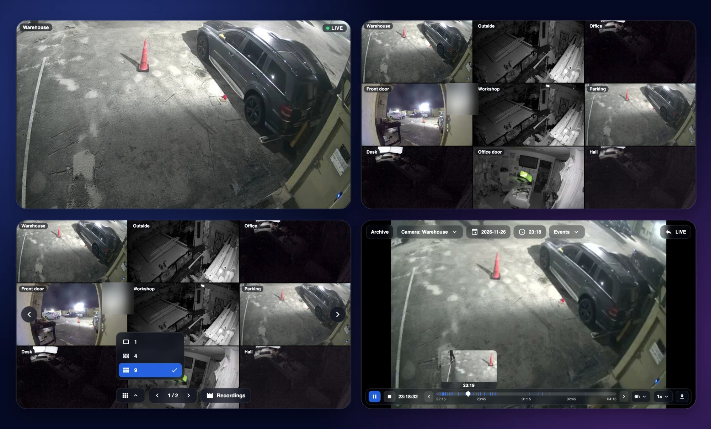

## MAestro Switch

**A compact switch.**

For any toggleable entity: lights, plugs, scripts, scenes, buttons. Separate colors for the on and off states and an optional icon; a long press opens the entity details.

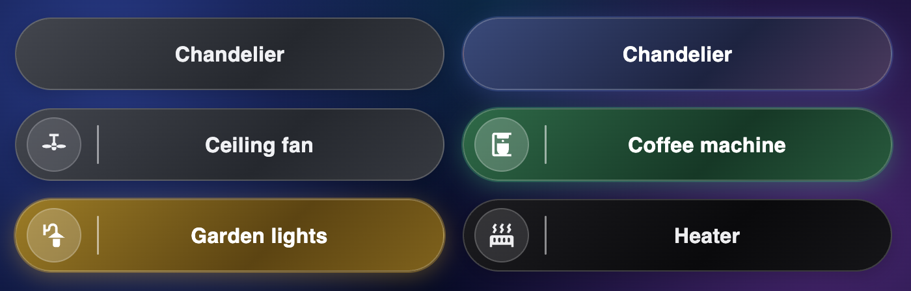

## MAestro Dimmer

**Power and brightness in one compact card.**

When off — the name and a power button. When on — a slider and the brightness percentage, with the background filling in color to match the level. Colors for both states are configurable.

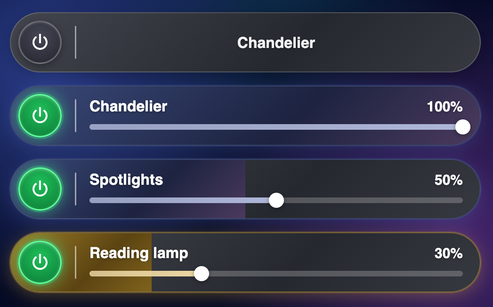

## MAestro Cover

**Shades, blinds and shutters.**

Open, stop and close buttons. Devices that support positions also get a slider and the open level in percent.

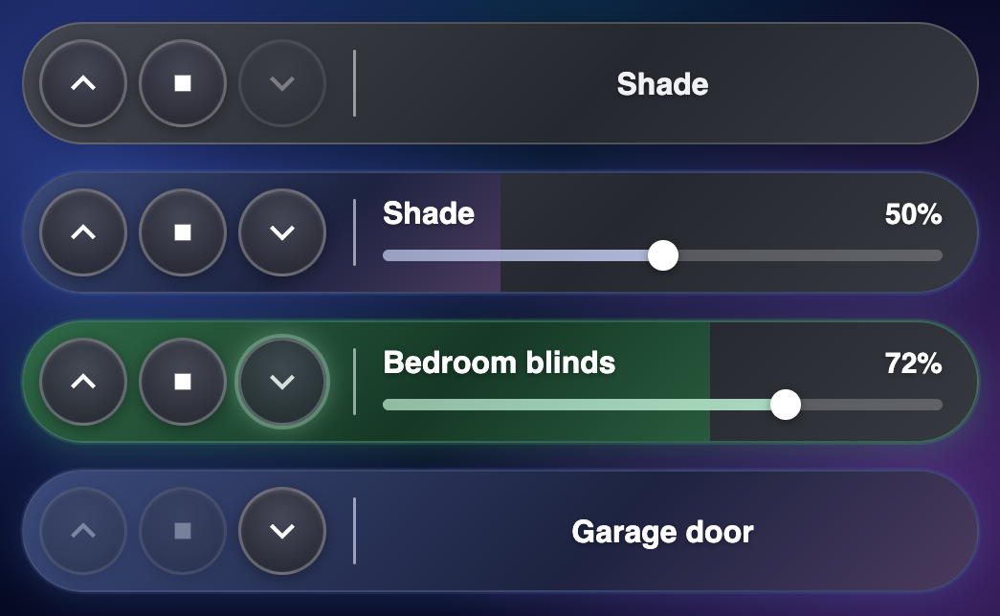

## MAestro Sensor and info badges

**Readings and states around the home.**

Temperature, humidity, air quality, open windows, motion or leaks — in one of these layouts:

- a value with a history graph;
- two values side by side;
- a device state or alert;
- a compact info badge.

Configurable colors and thresholds highlight the values that need attention.

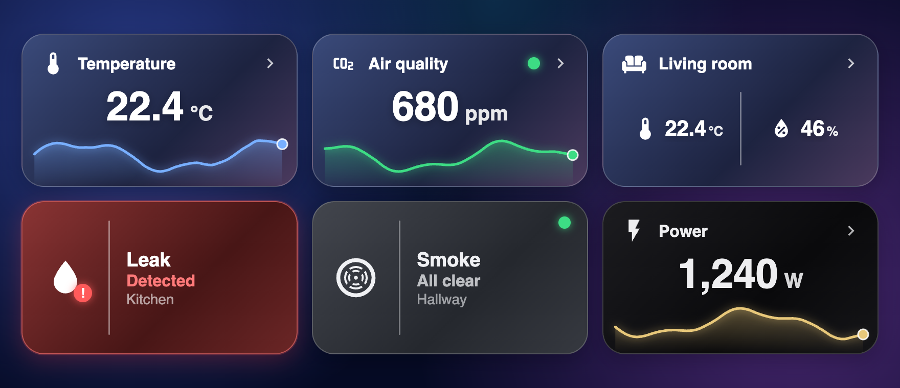

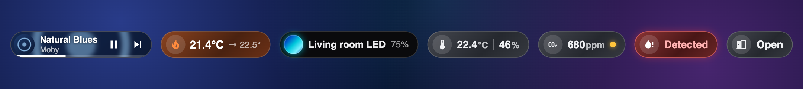

## Support the project

If you enjoy MAestro Cards, you can support its development — it helps the project grow and new cards to appear.

